# moNa2 ZMK firmware

Firmware for a moNa2 (two Seeed XIAO nRF52840, PAW3222 trackball on the right half), with
the layout of my Charybdis 3x5: the layers of my [Sweep](https://github.com/codeyoma/keyboard-zmk-sweep)
plus the Charybdis thumb keys (Mouse, Shift, Lower | Raise, Space). The other extra moNa2
keys are transparent for now.

- ZMK v0.3; the matrix, pins and trackball wiring come from the official
  [sayu-hub/zmk-config-moNa2-v2](https://github.com/sayu-hub/zmk-config-moNa2-v2).
- No dongle: the right half (trackball) is the central and connects to the computer.
- Mouse layer: hold the left outer thumb key. Laid out like the Charybdis QMK mouse layer:
  buttons on the right home row, G steps the trackball speed (4 levels), Z held slows it
  down (Snipe), V held or C toggled turns it into a scroll wheel.
- Flash `mona2_right` and `mona2_left` from the GitHub Actions artifacts.

